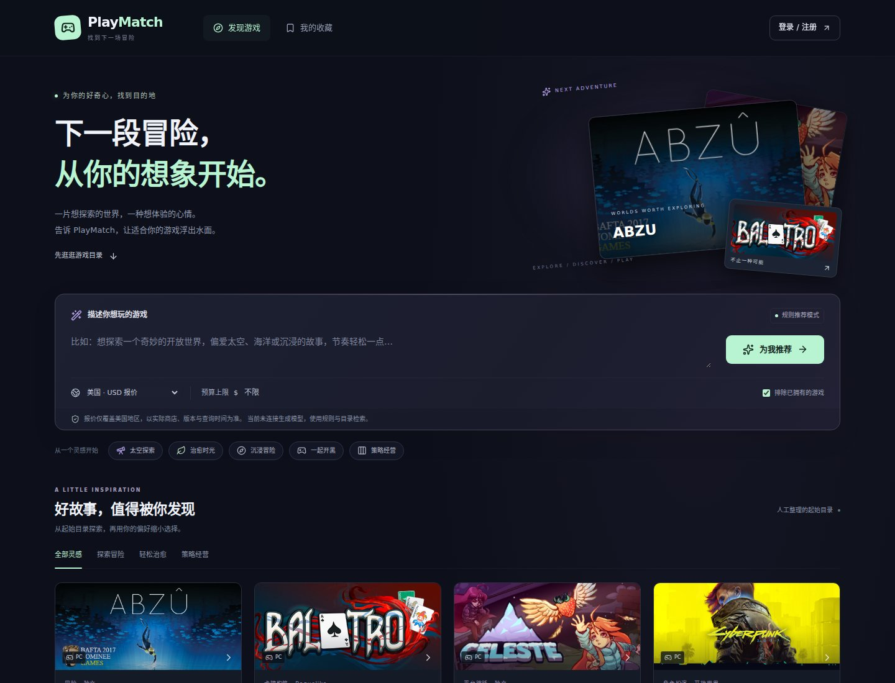
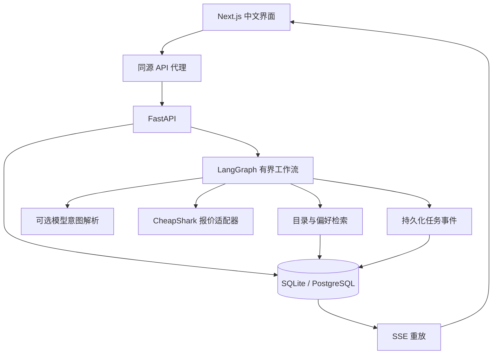

# PlayMatch

> 最新阶段：v0.6 来源目录与评测。默认48款真实作品（原24款 + 24款官方页面核对条目），支持BG3、CK3等编辑别名、实际数据覆盖面板及固定快照评测。资料与标签由开发助手整理，独立人工评审尚未完成。此前版本说明与验收数字是历史记录，当前范围见 [v0.6说明](docs/catalog-evaluation-v06.md)。


[](https://github.com/volcano-code/PlayMatch/actions/workflows/ci.yml)

**通过主题、偏好和约束发现游戏，再查看有来源、可核验的购买报价。**

PlayMatch 是分阶段实现的全栈 Agent 项目。首轮版本提供完整用户流程：中文主题输入 → LangGraph 推荐任务 → 流式进度 → 有依据的候选结果 → 按需查询报价 → 对比、收藏与偏好反馈。

无密钥即可启动。没有模型配置时，产品明确使用规则解析与 BM25 词项检索；有完整模型配置时，才执行真实的结构化意图解析。当前目录为 24 款人工整理的 PC 游戏，不冒充全量游戏索引。



[查看移动端截图](docs/screenshots/discover-mobile.jpg)

## 当前可用功能

| 能力 | 已实现行为 |
| --- | --- |
| 游戏发现 | 中文界面、主题输入、目录筛选、地区与预算、响应式布局 |
| 推荐工作流 | LangGraph 解析、检索、约束筛选、按需预算报价、解释；BM25 默认、可选向量融合与模型解析 |
| 可信约束 | 区分已核验和未知；负向主题、已拥有排除、平台、中文与合作条件；无法证明的条件明确提示 |
| 任务可靠性 | 数据库持久化 run/event、Idempotency-Key、SSE 与 Last-Event-ID 重放、有界并发与超时 |
| 购买辅助 | CheapShark 真实 USD 观测报价、整数金额、来源与查询时间、版本/激活不确定性 |
| 账号与偏好 | Argon2 哈希、HttpOnly 会话 Cookie、用户数据隔离、目标价、喜好与拥有反馈 |
| 游戏对比 | 最多三款并排比较；未知属性保留为待核验 |
| 目录运营 | 有界 IGDB 采集、带摘要审核包、显式批准和事务导入 |
| 向量索引 | 可选离线分批建库、增量复用、显式续建、原子激活及精确向量检索 |
| 工程验证 | 锁定依赖、Alembic、Python/前端单元测试、Playwright、PostgreSQL 与容器 CI |

### 三个使用边界

1. **报价范围是 US / USD。** 中国大陆模式可做主题推荐和收藏，目前没有可核验的国区人民币价格。不会把美元换算成国区售价。
2. **观测低价不等于保证可购最低价。** 供应商未提供足够的版本与激活证据，相关报价保留 `eligible_for_best=false`。预算未核验的候选会明确标记。
3. **目标价可以保存，自动通知未启用。** 当前没有后台价格轮询、邮件投递或购买行为。

## 快速启动

### Docker Compose

需要 Docker Engine 和 Compose v2。

```bash
git clone https://github.com/volcano-code/PlayMatch.git
cd PlayMatch
cp .env.example .env
docker compose up --build -d --wait
```

打开 **http://localhost:3000**。Compose 启动 Web、API 与 PostgreSQL，并执行数据库迁移。默认仅绑定本机端口，数据库不对宿主机公开。

```bash
docker compose logs -f api web
# 停止服务并保留数据库卷
docker compose down
```

### 本地开发

需要 Python 3.12、Node.js 24 和 uv。CI 使用 uv 0.12.23。

```bash
cp .env.example .env
uv sync --frozen --extra dev
npm --prefix apps/web ci
```

终端 A：

```bash
uv run uvicorn playmatch.main:app --host 127.0.0.1 --port 8000
```

终端 B：

```bash
npm --prefix apps/web run dev
```

本地使用 `.state/playmatch.db`，自动执行相同的 Alembic 迁移。Web 通过同源 `/api/` 代理访问 API；服务端地址默认为 `http://127.0.0.1:8000`，可在 `apps/web/.env.local` 设置 `API_INTERNAL_URL`。API 文档位于 http://127.0.0.1:8000/docs。

先试：`想探索太空和科幻世界`、`推荐有中文界面的在线合作游戏`、`想经营农场，节奏轻松一点`。输入 `不要恐怖元素` 或目录没有证据的人数限制时，可能得到明确空结果，这属于严格约束处理。

## 可选模型与数据源

在后端 `.env` 配置三项以启用模型意图解析：

```dotenv
LLM_BASE_URL=https://your-provider.example/v1
LLM_API_KEY=your-private-key
LLM_MODEL=your-supported-model
```

服务须支持兼容的 `/chat/completions` 接口与 JSON 对象输出。密钥只保留在后端；超时和结构化输出均有边界。模型失败时返回带提示的规则降级结果，不生成游戏或价格数据。本仓库不含模型密钥，也不声称已在真实模型账户上完成验证。

CheapShark 无需密钥。IGDB 的 client credentials 适配器已实现，新增审核后规范化文件的事务性导入；尚未自动同步。配置凭证不会把人工目录改标为 IGDB 目录。参见 [数据来源说明](docs/data-sources.md)。

## 架构与关键决定



- [ADR 0001：模块化单体与执行边界](docs/adr/0001-modular-monolith.md)
- [ADR 0002：价格可比性与证据](docs/adr/0002-price-evidence.md)
- [ADR 0003：推荐模式与硬条件](docs/adr/0003-truthful-agent.md)
- [API 与数据契约](docs/implementation-contract.md)
- [OpenAPI 规范](packages/contracts/openapi.json)

状态与事件持久化不等同于 LangGraph checkpoint 恢复。首轮 API 使用一个进程；中断的任务在下一次启动时变为明确失败，用户可重新提交。Redis/Celery 分布式投递和跨进程恢复尚未启用。向量检索可显式配置，实际质量与线上可用性仍需验证。

## 测试与复现

```bash
# 后端、供应商契约与领域逻辑
uv run --extra dev pytest -q
uv run --extra dev ruff check .
uv run --extra dev ruff format --check .
uv run python scripts/check_openapi.py

# 前端类型、流式解析与生产构建
npm --prefix apps/web run typecheck
npm --prefix apps/web test
npm --prefix apps/web run build

# 浏览器流程：自动启动独立测试 API 与 Web
npm --prefix tests/e2e ci
npx --prefix tests/e2e playwright install chromium
npm --prefix tests/e2e test

# 探索性开发评估，非独立盲测
uv run python scripts/evaluate_recommendations.py --check
```

浏览器测试使用独立 `.state/e2e.db`，覆盖真实前后端注册、会话、推荐/SSE、三款对比、国区不支持状态、目标价持久化、代理安全边界与手机布局。供应商契约测试使用确定性 HTTP fixtures；它们不证明上游在部署地始终可达。

小量真实来源验证需要显式执行：

```bash
uv run python scripts/probe_providers.py --live --output data/provider-probe.json
```

[供应商探针报告](data/provider-probe.json) 是记录时间点的状态快照，不代表持续可用性或当前价格。[开发评估说明](docs/evaluation.md) 区分了主题命中与完整推荐质量。PostgreSQL 迁移及跨重启持久化由 CI 独立验证，脚本为 `scripts/smoke_postgres.py`。

## 目录

| 路径 | 内容 |
| --- | --- |
| `apps/web` | Next.js 页面、交互组件、代理与流式解析 |
| `services/api/playmatch` | API、认证、模型、推荐图、任务执行与适配器 |
| `services/api/alembic` | 数据库版本迁移 |
| `data` | 人工目录与带时间的供应商探针 |
| `packages/contracts` | 导出的 OpenAPI |
| `tests/provider` / `tests/e2e` | 供应商契约 / 浏览器验收 |
| `evals` | 人工标注开发评估集 |
| `infra` / `.github` | 容器与 CI |
| `docs` | 来源、设计决策、评估与阶段记录 |

## 后续阶段

按 [阶段记录](docs/implementation-status.md) 推进真实 IGDB 同步、更大目录与语义质量评估、持久队列与 checkpoint 恢复。价格通知需要先确定允许的来源与用户授权流程。实际实现、验证结果与未接通能力分别记录；规划指标不会作为已实现的简历成绩。


## v0.2 恢复开发增量

默认检索升级为离线 BM25；原关键词模式保留用于对照。显式配置才使用 embedding + RRF，
失败会报告降级，真实向量质量仍待独立验收。新增审核后 IGDB 规范化记录的事务性 CLI 导入，
默认仅预演；相同键重复执行不会重复写入，冲突整批回滚，人工记录及已有游戏 ID 不覆盖。
原首轮说明是历史基线；本阶段行为与限制以 [v0.2 说明](docs/retrieval-import-v02.md) 为准。


## v0.3：目录采集与持久向量索引

详见 [配置、操作、恢复与验证](docs/catalog-index-v03.md)。IGDB 采集输出审核包，批准时绑定
内容 SHA-256；不会自动写库或把未知属性标为已核验。`indexed_hybrid` 使用显式构建的数据库
向量快照，用户请求只计算查询向量；索引过期、模型不符或异常时明确降级。常规启动仍无密钥。

真实模型探针使用隔离的 CPU 模型环境，不修改应用依赖，不调用付费 API；其开发评测不能
替代独立用户测试。价格、通知和分布式执行的原有未完成边界保持不变。

## v0.4：持久推荐任务与独立 worker

推荐任务和初始事件在同一事务入队，API 重启不再直接判失败。工作进程通过租约和
尝试令牌领取任务，从已提交的安全阶段接续；过期工作进程不能覆盖新结果。取消接口
与前端“取消任务”均已接通，刷新后可以“继续查看原任务”，不重复提交推荐请求。

Docker Compose 现在启动 **Web、API、worker、PostgreSQL**。本地 quickstart 仍默认
内嵌队列消费者；独立模式请设置 `RUN_EXECUTION_MODE=external`，API 完成迁移后执行
`uv run python -m playmatch.worker`。默认最多 3 次尝试、总时限 90 秒。

这是应用级阶段恢复，不是外部调用 exactly-once；完整边界及验收方法见
[持久任务说明](docs/durable-runs-v04.md)。升级前停止旧 API 进程，保留数据库卷。

## v0.5：主动查价站内提醒

“我的收藏”新增明确授权的一次性 USD 提醒，“通知中心”支持未读、已读、分页和删除。
只有主动点击“查价并检查提醒”才查询并评估；不持续抓价、不发送邮件，普通收藏不会开启。
投递使用现有独立 worker 与事务性 outbox，价格/版本未知不会伪装为保证可购买低价。
更改目标/地区或关闭提醒会阻止未提交投递。升级包含迁移0005，先备份并停止旧API/worker，
保留数据库卷，再 `docker compose up --build -d --wait`。
详细范围及复现：[price-alerts-v05.md](docs/price-alerts-v05.md)。

## v0.7：Steam 持续发现目录

新增独立 Steam full/delta 同步进程、持久游标/失败续传、数据库身份目录及前端状态/名称检索。
这不是继续把种子扩成96款；配置服务端Key并启动同步器后，范围由官方游戏目录实际返回决定。
“已发现名称”和“已有推荐资料”分开统计；没有Key时不会假装已导入全库。

操作见 [Steam 同步与边界](docs/steam-directory-v07.md)。首次配置后：
`docker compose --profile catalog-sync up --build -d --wait`。
自动元数据补全、全库语义召回及全库实时价格不属于本轮已完成能力。

## v0.8：自动资料补全与大目录候选接入

在 v0.7 Steam 身份目录之上新增可选 `metadata-enrichment` 服务：按 AppID
从 IGDB 获取资料，身份核对通过后原子写入资料与词项索引，自动进入推荐。
人工资料不覆盖；自动资料过期/冲突不进入推荐。大目录先用 SQL 倒排词项索引
召回有限候选，再执行已有排序与硬约束，避免每次把全库 JSON 加载进 Python。
这不是全库向量召回，也不表示当前环境已导入真实 Steam 全库。

默认不启用外部采集。服务端配置 Steam/IGDB 后，启用 `catalog-sync` 与
`metadata-enrichment` 两个 Compose profile。完整操作、配额与时效限制见
[自动资料补全文档](docs/metadata-enrichment-v08.md)。提供独立状态面板，配置、
进程、成功批次、可用资料数量分开显示；供应商简介不冒充已完成中文翻译。
