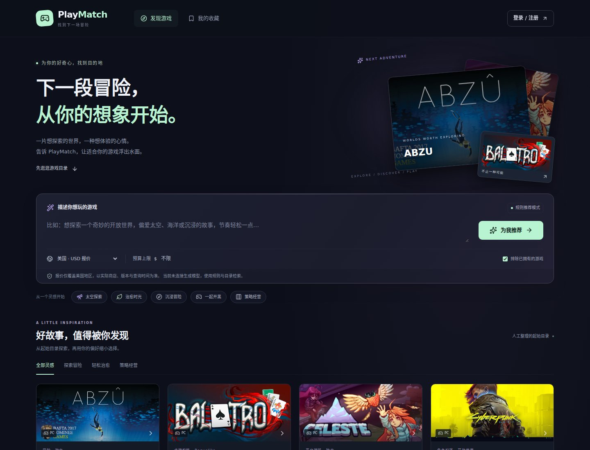
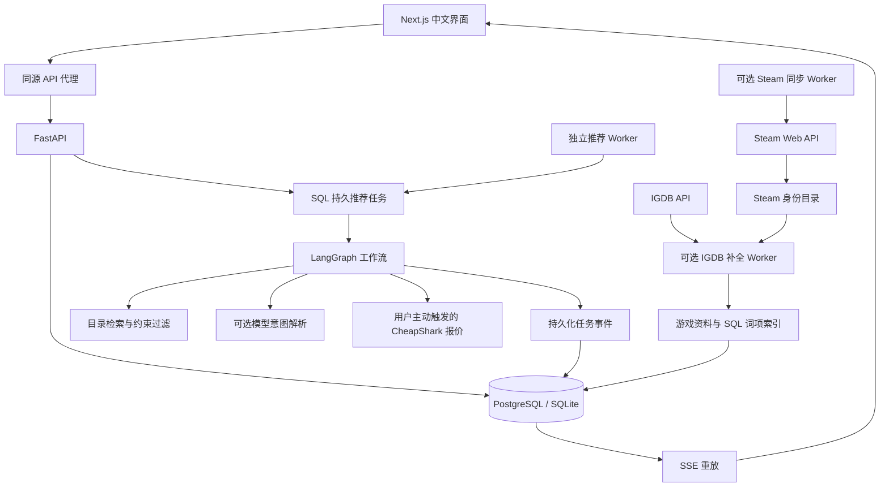

# PlayMatch

> **当前研发增量：v0.9 多数据源 Metadata Engine（建立在 v0.8 功能基线上）**。Steam AppID 身份目录、Steam Store 主资料源、可选 RAWG 精确身份补充、字段级证据和多来源 provenance 已进入实现与 CI 验收。默认离线推荐资料仍为 48 款；真实 Steam/RAWG 上游覆盖尚未在本开发环境执行。

[](https://github.com/volcano-code/PlayMatch/actions/workflows/ci.yml)

**通过主题、偏好和约束发现游戏，再查看有来源、可核验边界的购买报价。**

PlayMatch 是一个中文全栈游戏发现与购买辅助 Agent。用户描述想玩的题材、偏好和限制，系统解析需求、检索候选、执行硬约束过滤并解释推荐理由；用户也可以比较游戏、保存偏好，并在明确操作后查询美国地区的 USD 报价。



[查看移动端截图](docs/screenshots/discover-mobile.jpg)

## 当前能力

| 模块 | 已实现能力 |
| --- | --- |
| 游戏发现 | 中文主题搜索、目录筛选、别名搜索、响应式界面 |
| Agent 工作流 | LangGraph 意图理解、候选检索、约束过滤、报价阶段与推荐解释 |
| 意图解析 | 无密钥时使用规则解析；配置兼容 Chat Completions 模型后可启用结构化模型解析 |
| 检索 | 默认 BM25；可选 embedding/RRF 路径；大目录使用 SQL 倒排词项召回并限制载入候选正文数量 |
| 可信约束 | 区分 verified / unknown；处理平台、中文界面、合作、负向主题、预算和已拥有排除 |
| 持久任务 | SQL 持久队列、幂等提交、独立 worker、租约 fencing、有限重试、取消、SSE 重连 |
| 用户系统 | Argon2 密码哈希、HttpOnly 会话 Cookie、CSRF 与账户数据隔离 |
| 个性化 | 收藏、目标价、喜好/不喜欢/已拥有反馈 |
| 价格提醒 | 用户明确授权后的一次性 US/USD 查价与站内通知 |
| Steam 目录 | 可选全量/增量身份发现、持久游标、失败续传和状态查询 |
| Metadata Engine | Steam Store 主资料源；可选 RAWG 精确 Steam 链接补充；IGDB 保留为可选 legacy provider；多来源 provenance 与冲突保护 |
| 工程验证 | Alembic、锁定依赖、OpenAPI 检查、Python/前端/Playwright 测试、PostgreSQL 与容器 CI |

## 数据和产品边界

- **默认推荐资料目录是 48 款离线整理作品，不是 Steam 全库。** Steam 官方身份同步先建立 AppID/名称目录；只有资料源返回的 AppID 精确匹配、PC/基础游戏和来源检查通过后，才进入推荐资料表。
- **发现身份不等于可推荐资料。** 未补全、冲突或缺少证据的记录不会被编造成完整游戏条目。自动补全按 AppID 精确匹配，不以标题相似度兜底。
- **大目录召回不是全库 ANN。** 当前大目录使用 SQL 倒排词项先召回有限候选，再执行现有排序与硬约束；词项不重合和候选截断仍可能漏掉结果。不能把合成容量测试当成真实覆盖率或推荐质量指标。
- **中文与玩法标签保持保守。** Steam Store 明确列出的简体中文支持可作为供应商正向证据；缺失仍为 unknown。合作模式只在商店明确列出 Online Co-op / Local Co-op 时赋值；不从缺失字段推断否定结论。
- **价格只覆盖当前已接通的 US/USD CheapShark 观测报价。** 报价不保证版本、激活地区或结算资格等价，也不保证最低可购价；没有证据时保留未知，不将美元换算成国区人民币售价。
- **价格提醒不是持续监控。** 用户需要明确开启一次性规则并主动点击“查价并检查提醒”；目前没有后台持续轮询或外部邮件投递。
- **真实上游需要部署后验收。** Steam Store AppDetails 是未文档化的 best-effort 商店接口，不是官方 Web API；RAWG 需要自行申请 API Key，且必须遵循其当前计划、署名和使用条款。HTTP fixture、合成数据和容量测试不代表已经抓取真实全库或证明上游持续可用。
- **不是生产 SLA 声明。** 公开部署仍需自行完成 HTTPS、限流、邮箱验证/找回、备份恢复演练、监控和持续运行验收。

## 快速启动

### Docker Compose（推荐）

需要 Docker Engine 和 Docker Compose v2。

```bash
git clone https://github.com/volcano-code/PlayMatch.git
cd PlayMatch
cp .env.example .env
docker compose up --build -d --wait
```

打开 [http://localhost:3000](http://localhost:3000)。默认 Compose 启动 Web、API、PostgreSQL 和独立推荐 worker；Steam 身份同步与 Metadata 补全服务默认不启动。Web 端口只绑定宿主机 loopback，数据库不对宿主机公开。

```bash
docker compose logs -f api worker web
docker compose ps
# 停止服务并保留数据库卷
docker compose down
```

本地开发默认密码仅用于本地体验。部署到可访问网络前，请在服务端配置强随机 `POSTGRES_PASSWORD`、正确的 `ALLOWED_ORIGINS`，并按 HTTPS 设置 `COOKIE_SECURE=true`。

### 本地开发（SQLite）

需要 Python 3.12（支持范围 3.12–3.13）、uv 0.12.23、Node.js 22.13+（CI 使用 Node 24）。

```bash
cp .env.example .env
uv sync --frozen --extra dev
npm --prefix apps/web ci
```

终端 A，启动 API（默认 SQLite、内嵌 SQL 队列消费者，并在启动时执行迁移）：

```bash
uv run uvicorn playmatch.main:app --host 127.0.0.1 --port 8000
```

终端 B，启动前端：

```bash
npm --prefix apps/web run dev
```

打开 [http://localhost:3000](http://localhost:3000)，API 文档位于 [http://127.0.0.1:8000/docs](http://127.0.0.1:8000/docs)。本地数据库默认保存在 `.state/playmatch.db`。Web 通过同源 `/api/` 代理访问 API；需要时可在 `apps/web/.env.local` 设置 `API_INTERNAL_URL`。

如需在本地单独运行推荐 worker，先在 API 和 worker 共用的环境中设置 `RUN_EXECUTION_MODE=external`，启动 API 并等待迁移完成，再在另一个终端执行：

```bash
uv run python -m playmatch.worker
```

不要让不同代码版本同时消费同一个任务数据库。队列和阶段快照是应用层 SQL 实现，不是 Redis/Celery，也不是 LangGraph 原生 checkpointer。

## 可选模型和检索配置

在后端 `.env` 配置以下三项，才会启用真实模型意图解析：

```dotenv
LLM_BASE_URL=https://your-provider.example/v1
LLM_API_KEY=your-private-key
LLM_MODEL=your-supported-model
```

服务需支持兼容的 `/chat/completions` 接口和 JSON 对象输出。密钥只放在后端环境；模型不可用或结构化结果不合格时，系统按实现边界降级并提示，不生成游戏或价格数据。

检索模式与 LLM 意图解析相互独立。默认 `RETRIEVAL_MODE=bm25`，embedding/RRF 路径需要单独配置 embedding 服务；`indexed_hybrid` 还需要先由操作员构建兼容的持久索引。大目录的 SQL 倒排候选召回不应被描述为全库向量检索。索引操作和兼容性规则见 [catalog-index-v03.md](docs/catalog-index-v03.md)。

## 启用 Steam 身份同步与多数据源 Metadata Engine

数据采集分成两个独立服务：

1. **Steam identity worker**：通过官方 IStoreService 身份目录同步 AppID 和名称，需要 Steam Web API Key。
2. **Metadata worker**：默认使用 Steam Store AppDetails 作为主资料源；可选调用 RAWG 补充类型和标签，但只有 RAWG 结果包含与当前 Steam AppID 完全一致的 Steam 商店链接时才接受。IGDB 仍保留为可选 legacy provider，不再是默认前置条件。

先阅读 [Steam 同步说明](docs/steam-directory-v07.md) 和 [多数据源 Metadata Engine 说明](docs/multi-source-metadata-v09.md)。

服务端 `.env`：

```dotenv
# Steam identity sync (official IStoreService)
STEAM_WEB_API_KEY=your-steam-server-key
STEAM_SYNC_ENABLED=true

# Metadata provider: steam_rawg (default), steam_store, or legacy igdb
METADATA_PROVIDER=steam_rawg
METADATA_ENRICHMENT_ENABLED=true

# Optional RAWG supplement; Steam Store primary source works without this key
RAWG_API_KEY=
```

启动服务：

```bash
docker compose --profile catalog-sync --profile metadata-enrichment up --build -d --wait
docker compose logs -f catalog-sync metadata-enrichment
```

如果暂时没有 Steam Web API Key，可先对已有 `steam_directory_apps` 记录运行 Metadata worker；Steam Store 主资料查询本身不需要 Steam API Key。要新增 Steam 身份，仍需启用 catalog-sync。

RAWG 的免费计划条款目前要求非商业使用并在使用其数据/图片的页面署名和链接；若项目未来商业化，应先核实并取得适用商业授权。参见 [RAWG API 计划和条款](https://rawg.io/apidocs)。

状态接口：

- `GET /api/v1/catalog/steam/status`：Steam 身份发现、心跳、游标和失败状态。
- `GET /api/v1/catalog/enrichment/status`：当前 provider、worker、成功批次、积压和可用资料情况。

**配置完成不等于同步成功。** 先执行只读预检，再做一页 Steam 身份同步和一批 Metadata 补全，检查实际 AppID、来源记录、字段证据和拒绝原因。不要把合成容量测试当作真实上游覆盖。

## Steam / Metadata 接入预检

在配置真实凭证前，可以先执行只读预检。它不会请求 Steam、RAWG 或 IGDB，启动 worker 或修改数据库，也不会输出密钥：

```bash
uv run python scripts/check_ingestion_readiness.py
# API 启动并完成迁移后，读取运行状态：
uv run python scripts/check_ingestion_readiness.py --api-base-url http://127.0.0.1:8000
# 部署验收时可启用严格门禁：
uv run python scripts/check_ingestion_readiness.py --require-steam --require-metadata
uv run python scripts/check_ingestion_readiness.py --api-base-url http://127.0.0.1:8000 --require-api --require-steam-full-sync --require-metadata-success
```

报告会区分“已配置”与“已完成真实同步”。详细字段、严格门禁和安全边界见 [ingestion-readiness-v09.md](docs/ingestion-readiness-v09.md)。

## 用户主动触发的价格提醒

CheapShark 不需要 API Key。用户登录后可在收藏中设置 US/USD 目标价、阅读并同意授权说明、开启一次性规则，再主动点击“查价并检查提醒”。符合条件的观测结果会进入站内通知中心。收藏、普通报价查询和页面刷新不会自动开启提醒；没有持续后台抓价或外部邮件投递。

## 测试与复现

```bash
# Python 后端、供应商契约和领域逻辑
uv run ruff check .
uv run ruff format --check .
uv run pytest -q
uv run python scripts/check_openapi.py

# 前端类型、单元测试、格式和生产构建
npm --prefix apps/web run typecheck
npm --prefix apps/web run format:check
npm --prefix apps/web test
npm --prefix apps/web run build

# 浏览器端到端测试（需要 Playwright Chromium）
npm --prefix tests/e2e ci
npx --prefix tests/e2e playwright install chromium
npm --prefix tests/e2e test

# 固定开发评测；不是独立盲测
uv run python scripts/evaluate_recommendations.py --check
uv run python scripts/benchmark_catalog.py evaluate --check --output /tmp/catalog-v06-results.json
cmp /tmp/catalog-v06-results.json evals/catalog-v06-results.json

# Compose 配置检查
docker compose config --quiet
```

PostgreSQL 专项测试、迁移冒烟、独立 worker、Steam/IGDB 合成集成测试及大目录合成容量测试见 [CI 工作流](.github/workflows/ci.yml) 和对应验收报告。专用 PostgreSQL 测试必须使用空的、可丢弃的测试数据库，**绝不能指向真实运行数据库**。

## 架构概览



关键设计与契约：

- [实现契约及增量](docs/implementation-contract.md)
- [运行与部署说明](docs/deployment.md)
- [数据来源说明](docs/data-sources.md)
- [v0.4 持久任务边界](docs/durable-runs-v04.md)
- [v0.5 价格提醒边界](docs/price-alerts-v05.md)
- [v0.6 目录与评测说明](docs/catalog-evaluation-v06.md)
- [v0.7 Steam 身份同步](docs/steam-directory-v07.md)
- [v0.8 IGDB 自动补全（历史适配器）](docs/metadata-enrichment-v08.md)
- [v0.9 多数据源 Metadata Engine](docs/multi-source-metadata-v09.md)
- [v0.9 多数据源验收记录](docs/validation-v09-multi-source.md)
- [阶段记录](docs/implementation-status.md)
- [v0.8 验收记录](docs/validation-v08.md)

## 开发路线

当前核心产品基线为 v0.8，v0.9 正在推进多数据源 Metadata Engine。后续计划按以下顺序推进：

1. **P0 工程基线对齐**：修复文档、运行模式、环境配置和验收说明之间的漂移。
2. **P1 真实数据验收**：先验收 Steam Store 小批量资料，再配置 RAWG Key 做精确链接补充；IGDB 仅作为可选 provider。
3. **P2 推荐引擎升级**：在保留 BM25 基线的前提下，实验 Dense Retrieval、Reranker、多轮需求澄清和个性化排序。
4. **P3 独立评测**：建立独立查询与人工标注集，报告检索/排序质量、硬约束违规、延迟与成本。
5. **P4 产品化**：完善地区价格覆盖、监控、备份恢复、账号找回与生产部署。

不把计划、合成测试、开发挑战集或未配置的供应商能力写成已交付成果。
